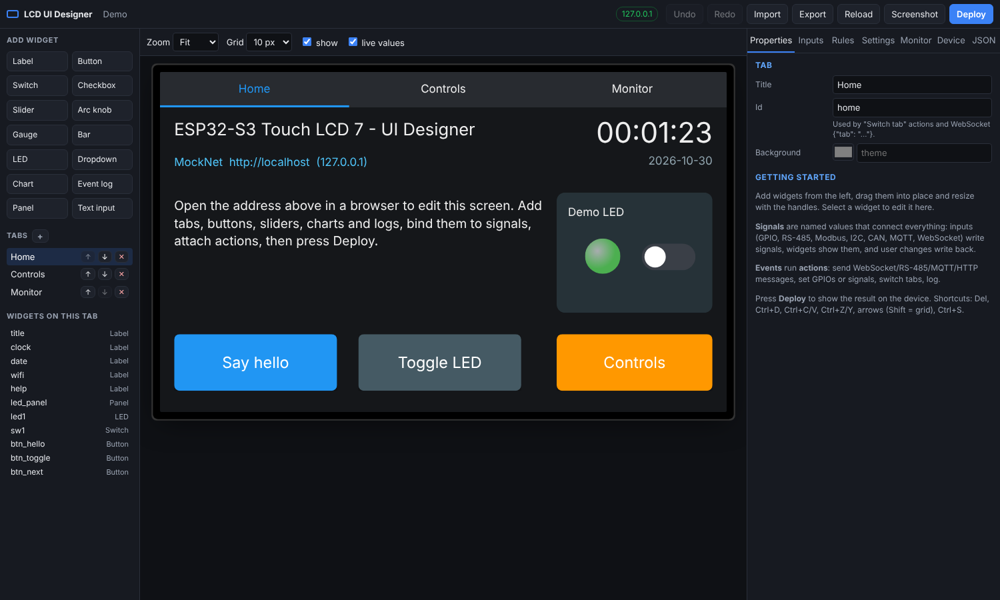

# ESP32-S3 Touch LCD 7 – UI Designer

ESP-IDF firmware for the **Waveshare ESP32-S3-Touch-LCD-7** (800×480) that lets
you design the touch screen in a web browser instead of reflashing. The device
hosts a drag-and-drop editor; you place tabs and LVGL widgets, connect them to
data (WebSocket, GPIO, RS-485/Modbus, I2C, CAN, MQTT) and attach actions, then
press **Deploy** and the screen updates.



## Features

* **Web editor served by the device**: drag and resize widgets on a scaled
  preview of the screen, with snap grid, undo/redo, copy/paste, import/export
  of layouts as JSON, live values while you edit, and a screenshot of the real
  screen.
* **Widgets** (LVGL 9): label, button (momentary or toggle), switch, checkbox,
  slider, arc knob, gauge, bar, LED, dropdown, line/bar chart, event log,
  panel, text input with on-screen keyboard. Multiple tabs.
* **Signals** connect everything: named values that inputs write, widgets
  show, and user changes write back (two-way binding).
* **Inputs**: GPIO (debounced), ADC, I2C register polling, RS-485 text lines
  (`line`, `name=value`, JSON), Modbus RTU master polling, CAN frames, MQTT
  topics, WebSocket and REST.
* **Actions** on widget events: send WebSocket / RS-485 / Modbus / CAN / I2C /
  MQTT / HTTP messages, set GPIOs or signals, switch tab, write to the event
  log, control the backlight, wait. Payloads are templates such as
  `{"pump": {value}}` or `01 06 00 10 {value:hex16}`.
* **Rules**: "when `temp` > 80, publish an alarm" style automations without a
  widget.
* **Deploy without reflashing**: layouts are stored in LittleFS with automatic
  backup and one-click rollback. Firmware updates (OTA) can also be uploaded
  from the browser, with automatic rollback if the new image fails to boot.
* WiFi setup access point on first boot, mDNS (`http://lcd-ui.local`), SNTP
  clock, optional screen saver.

## Getting started

### 1. Build and flash

You need **ESP-IDF v5.5 or newer** (tested with v5.5.6 and v6.1).
Dependencies (LVGL 9.4, esp_lvgl_port, the GT911 driver, LittleFS, mDNS, and
on IDF 6 cJSON and MQTT) are downloaded by the component manager on the first
build.

```bash
idf.py set-target esp32s3
```

```bash
idf.py build
```

Connect the board's **UART** USB-C port and flash (replace the port):

```bash
idf.py -p /dev/ttyUSB0 flash monitor
```

Optional: `idf.py menuconfig` → *LCD UI Designer* to preset a WiFi network,
hostname, the setup access point password and the panel clock.

### 2. Connect

* With no WiFi configured the device opens an access point
  **`LCD-UI-XXXX`** (password `lcdsetup`). Join it and open
  `http://192.168.4.1`. The screen shows these details too.
* In the editor open **Device → WiFi**, scan, pick your network and *Save &
  connect*. Afterwards the editor is at **`http://lcd-ui.local`** (or the IP
  address shown on the screen). If the network cannot be reached for 20 s,
  the setup access point comes back.

### 3. Design

1. Add widgets from the left panel, drag them into place, resize with the
   handles.
2. In **Properties** set the text, colours and the **signal** the widget shows
   or controls.
3. Under **Events** add actions, e.g. *When clicked → Send on RS-485
   `PUMP ON`* or *When value changed → MQTT publish `{value}`*.
4. Use **Inputs** to feed signals from hardware, **Rules** for automations,
   **Settings** for theme, tab bar, time zone and the RS-485 / CAN / MQTT ports.
5. Press **Deploy** (Ctrl+S). The layout is saved on the device and the screen
   is rebuilt within a second.

**Monitor** shows live signal values and WebSocket traffic and lets you set
values for testing. **JSON** shows the full layout for copy/paste or hand
editing.

The full layout format, every widget/action/input option, the WebSocket
protocol and the REST API are documented in
[docs/layout-format.md](docs/layout-format.md).

### Talking to the panel from other programs

Any WebSocket client can connect to `ws://lcd-ui.local/ws`:

```json
{"set": {"boiler.temp": 64.5, "status": "Heating"}}
```

and receives `{"signals": {...}}` updates and widget events such as
`{"event":"clicked","widget":"btn_pump","value":1}`. This works well with
Node-RED, Home Assistant (or use MQTT), Python scripts or a PC application.

## Hardware notes

The pin map is in `main/board/board_config.h`:

| Function | Pins |
|---|---|
| RGB panel (ST7262, 16-bit) | GPIO0–3, 5, 7, 10, 14, 17, 18, 21, 38–42, 45–48 |
| I2C (GT911 touch, CH422G, I2C header) | SDA GPIO8, SCL GPIO9 |
| Touch interrupt | GPIO4 |
| CH422G expander | EXIO1 touch reset, EXIO2 backlight, EXIO3 LCD reset, EXIO4 SD CS, EXIO5 USB/CAN select |
| RS-485 (UART1, automatic direction) | TX GPIO16, RX GPIO15 |
| CAN (TWAI) | TX GPIO20, RX GPIO19 (shared with native USB) |
| TF card (SPI) | MOSI 11, SCK 12, MISO 13 |
| Free for inputs/outputs | GPIO6 ("Sensor" ADC header), and GPIO15/16, 19/20, 43/44 if RS-485, CAN/USB or the UART0 console are not used |

Things to know:

* Nearly all GPIOs drive the display, so **plain GPIO I/O is limited**. For
  more I/O, put an I2C expander or ADC on the I2C header (and use `i2c`
  inputs and `i2c_write` actions), or a Modbus I/O module on RS-485.
* The board exposes **no free SPI bus** (the SPI pins go to the TF card), so
  SPI devices are not supported as inputs.
* The I2C header shares the bus with the touch controller (0x5D/0x14) and the
  CH422G (0x23, 0x24, 0x26, 0x30–0x3F). Avoid these addresses.
* The backlight is on/off only (no PWM dimming) on this board.
* If RS-485 receives nothing, swap `BOARD_RS485_TX`/`RX`; if CAN does not
  work, flip `BOARD_USB_SEL_CAN_LEVEL`. Both can differ between board
  revisions.

The display runs in LVGL direct mode with two PSRAM frame buffers and bounce
buffers, and code executes from PSRAM so the image stays stable while flash is
written (layout saves, OTA). If the picture drifts or flickers when WiFi is
busy, lower *RGB pixel clock* in menuconfig.

## Project layout

```
main/
  main.c                 boot sequence, layout load/apply/rollback
  board/                 CH422G, RGB panel, GT911 touch, LVGL port, pin map
  core/                  signals, actions worker, templates, WiFi/mDNS/SNTP, LittleFS, utils
  io/                    GPIO/ADC/I2C polling, RS-485 + Modbus RTU, CAN, MQTT
  ui/ui_engine.c         layout JSON -> LVGL widgets, bindings, rules, log/chart logic
  web/web_server.c       REST API, WebSocket, OTA, screenshot, serves the editor
  www/                   the editor (plain HTML/CSS/JS, gzipped into the firmware at build time)
  default_layout.json    example layout used until you deploy your own
tools/
  mock_server.py         fake device API for working on the editor without hardware
  gzip_file.py           build helper
test/host/               unit tests for formatting, templates, signals, decoding (gcc)
docs/layout-format.md    layout, WebSocket and REST reference
```

## Development without hardware

Run the editor against a simulated device:

```bash
python3 tools/mock_server.py --port 8080
```

and open `http://localhost:8080`. Edits to `main/www/` show up on reload.

Host unit tests (needs gcc and a cJSON checkout):

```bash
CJSON_DIR=/path/to/cJSON test/host/run.sh
```

## Limitations and ideas

* The built-in fonts cover ASCII plus `°`; for æ, ø, å or other characters,
  generate a Montserrat subset with LVGL's font converter and add it to
  `font_for()` in `ui_engine.c`.
* No password on the editor or API yet (cross-site requests from other web
  pages are blocked, but anyone on your network can open the editor). A
  password with HTTP Basic auth would be a small addition.
* Possible next steps: images and icons uploaded to LittleFS, conditional
  visibility (show a widget only when a signal matches), multi-select in the
  editor, data logging to the TF card, an RS-485 / Modbus slave mode, and
  Home Assistant MQTT discovery.
